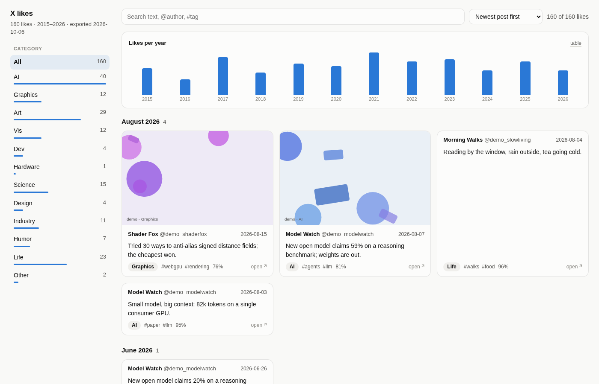
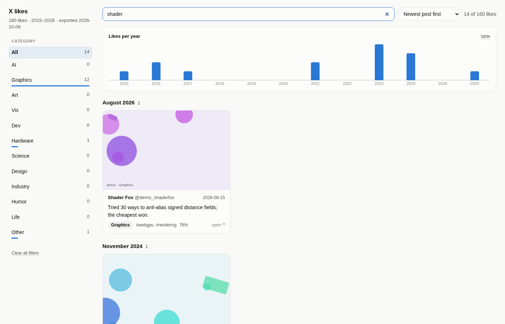

# x-likes — archive, categorize and browse your X/Twitter likes

One script, no X API key. It drives a real Chromium window with its own persistent profile: you log
in once, then it scrolls your Likes page and saves the full tweet JSON that X sends to the page
(text, author, date, photos, video URLs, quoted posts). Claude sorts everything into the categories
in `categories.json`, and a local viewer lets you browse, search and filter it all.

**Everything stays on your machine.** Your login session (`.browser-profile/`) and your likes
(`data/`, `media/`, `out/`) are git-ignored and never leave your computer.



## Try it without an account

The repo ships a **demo**: 160 made-up likes (invented `@demo_…` authors, example.com links,
generated pictures) in `demo/`. After cloning, with just Python 3 and a browser:

```
./xlikes-view --demo
```

## How it works

1. **Collect:** `./xlikes scrape` opens Chromium with its own profile on your Likes page and
   scrolls. Each page of likes X loads arrives as JSON (the same data the website uses); the script
   keeps the raw responses and writes one clean record per like to `data/likes.jsonl`.
2. **Categorise:** `./xlikes categorize` sends batches of likes (text, author, alt text, links) to
   Claude, which picks one category from `categories.json` (edit it to taste), up to three tags and a
   confidence, saved in `data/categories.jsonl`.
3. **Browse:** `./xlikes-view` exports everything (`out/`: a viewer page plus Markdown, CSV and JSON)
   and opens it: filter by category, search text, `@author` or `#tag`, sort by post date or by when
   you liked it.



## Quick start

```
./xlikes-view                         # open the viewer of what you have already collected (--demo: the demo)
./xlikes scrape --incremental         # collect new likes (a browser window opens; stops at likes you have)
./xlikes categorize && ./xlikes-view  # classify the new ones, then look at them
```

## First-time setup

1. Requirements: Python 3.10+ and Chromium (the script uses `/usr/bin/chromium`; set
   `XLIKES_BROWSER=/path/to/chrome` for another browser, or run `.venv/bin/playwright install chromium`
   to use Playwright's own build).
2. `./xlikes stats` creates the venv (`.venv/`, Playwright from `requirements.txt`) on first use.
3. Optional: `./xlikes-view --install-desktop` adds **X Likes** to your app menu (a `.desktop` entry
   in `~/.local/share/applications`), so you can open the viewer with a click.
4. Categorizing uses Claude: the `claude` CLI (`claude -p`) if installed, or the API if
   `ANTHROPIC_API_KEY` is set.

## Log in once

`./xlikes login` (or just the first `./xlikes scrape`) opens a Chromium window with the script's own
profile. Log in to X there as usual; X may ask for your 2FA code. The script never sees your
password; the session is kept in `.browser-profile/` (mode 0700) for later runs. It's separate from
your normal browser.

## Collect more likes

```
./xlikes scrape --incremental            # newest first; stops once it reaches likes already saved
./xlikes scrape --incremental --headless # same, with no window (once you're logged in)
./xlikes categorize                      # classify the new ones (only what isn't done yet)
./xlikes media                           # optional: download photos (add --video for mp4s)
```

A plain `./xlikes scrape` walks your whole Likes timeline (the first run took a few minutes per
thousand likes). It is paced (one page of ~20 likes every 2–3 s); on X's rate limit (HTTP 429) it
waits for the reset and carries on, and progress is saved continuously, so Ctrl-C and re-run is
safe. This uses your own logged-in session rather than X's paid API, which X's terms don't
sanction: keep it slow and occasional (it's your account).

## Open the viewer

`./xlikes-view` (or **X Likes** in the app menu) opens `out/index.html` in your browser: every like
as a card, filter by category, search text/@author/#tag, sort by post date or by when you liked it,
likes per year. It re-exports first if you collected anything new. It works offline from the local
files (images load from X's servers unless you ran `./xlikes media`). `./xlikes export` also writes
Markdown per category, CSV and JSON to `out/`.

## Where the data lives (local only, git-ignored)

| Path | What |
|---|---|
| `.browser-profile/` | the X login session for this script (keep private) |
| `data/likes.jsonl` | one normalized tweet per line; `data/raw/*.jsonl.gz` the raw responses |
| `data/categories.jsonl` | the classification of each tweet |
| `media/<tweet_id>/` | downloaded photos and videos |
| `out/` | the viewer (`index.html` + `likes.js`) and the exports |

## Layout

```
x_likes.py          the script            categories.json   editable taxonomy + tie-break notes
viewer.html         the browsable page    out/likes.js      its data (both written by export)
.browser-profile/   your X login (0700)   data/likes.jsonl  one normalized tweet per line
data/raw/*.jsonl.gz raw GraphQL responses data/categories.jsonl  classification per tweet id
media/<id>/         downloaded media      out/              generated exports
```

## Categories

Edit `categories.json` (names, descriptions, tie-break notes) and run `./xlikes categorize` again:
anything classified under an older version of the file is re-done automatically; `--all` redoes
everything. Each tweet gets one category, up to three free-form tags and a confidence, so you can
re-slice later without re-running the model (`out/likes.json` has it all).

## Keeping it up to date

`./xlikes scrape --incremental` stops once it reaches likes that are already saved. Add `--headless`
once you have logged in (the profile keeps the session). Then `categorize`, `media`, `export`.

## Completeness and the official archive

The web Likes timeline is what X chooses to serve, and for very old likes it may stop early. The
official data export (X → Settings → Your account → Download an archive of your data; takes a day or
so to arrive) lists every like ever, but only as tweet ID + text. To fold it in:

```
./xlikes import-archive ~/Downloads/twitter-2026-….zip   # or the unzipped folder or data/like.js
./xlikes enrich                                           # visits each archive-only post to get author/date/media
```

## Rate limits and caveats

- Scrolling is paced (about one page of ~20 likes every 2–3 s). On an HTTP 429 the script waits
  for X's reset time, clicks Retry and carries on. Progress is saved continuously; Ctrl-C and re-run
  to resume.
- This uses your own logged-in session rather than the paid API, which X's terms don't sanction.
  Kept slow and single-account it is very unlikely to draw attention, but that risk is yours.
- If X changes its response format, `data/raw/` keeps everything: fix the parser, run
  `./xlikes reparse`, no re-scraping needed.
- `scrape --handle you` overrides handle auto-detection if the profile link ever moves.
